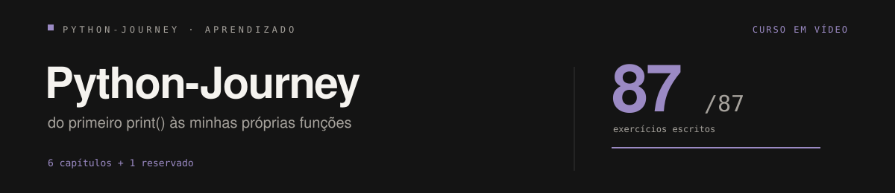

# Minha Jornada em Python

> **Portfólio da minha progressão no aprendizado de Python** — do primeiro `print()` até as minhas próprias funções. Cada arquivo é um exercício praticado, corrigido e evoluído, na ordem em que aprendi.




**85 de 86 exercícios escritos** · 5 capítulos concluídos · capítulo 06 em 9/10 (`ex105` pendente) · capítulo 07 reservado.

**Base do estudo:** o [curso de Python do Curso em Vídeo](https://www.youtube.com/@CursoemVideo) (Gustavo Guanabara), que percorre três "mundos". Reorganizei todo o conteúdo em **6 capítulos de progressão + 1 reservado**, que contam a história do meu aprendizado, do básico ao intermediário.

---

## Como o portfólio está organizado

```
Programação/
├── 01-fundamentos/            12 arquivos — print, input, tipos, operadores, módulos
├── 02-condicoes/              16 arquivos — if/elif/else, comparações, jogos
├── 03-lacos-e-logica/         25 arquivos — for, while, break, contadores, menus
├── 04-listas-e-tuplas/        18 arquivos — coleções, fatiamento, matrizes
│   ├── listas/                Ex78 a Ex89 do curso
│   └── tuplas/                práticas com tuplas
├── 05-dicionarios/            5 arquivos  — ex90, 91, 93, 94 e 95: chave/valor
├── 06-funcoes/                9 resolvidos + ex105 pendente — funções próprias
└── 07-proximos-aprendizados/  reservado: POO, bancos de dados, web, projetos
```

Cada arquivo tem no nome o **conceito que treina**, com o número da ordem em que aprendi — abrindo qualquer pasta, dá para ver a evolução em sequência.

---

## Capítulo 01 — Fundamentos

Minha estreia com código. Aprendi a conversar com o computador: pedir dados com `input()`, responder com `print()`, transformar texto em número e montar os primeiros cálculos.

| Arquivo | O que o código faz | O que aprendi |
|---|---|---|
| 01 - Calculadora Simples.py | As 4 operações, escolhidas pelo usuário | Primeiro `if`/`elif` escolhendo caminhos |
| 02 - Dobro, Triplo e Raiz.py | Mostra dobro, triplo e raiz de um número | Operadores aritméticos e `** (1/2)` para raiz |
| 03 - Conversão de Medidas.py | Converte metros em centímetros e milímetros | Multiplicação encadeada e saída formatada |
| 04 - Área da Parede.py | Calcula a área de uma parede | Variáveis guardando resultados intermediários |
| 05 - Média de Notas.py | Média de 2 ou 3 notas, conforme a quantidade | Condição sobre a própria entrada |
| 06 - Calculadora de Desconto.py | Aplica % de desconto sobre o preço | Cálculo de porcentagem |
| 07 - Conversor de Moeda.py | Converte reais em dólares | Cálculo direto e f-strings |
| 08 - Tabuada Simples.py | Monta a tabuada do número escolhido | Organizar resultados de cálculo em colunas |
| 09 - Primeiro Módulo (Math).py | Mostra a porção inteira de um decimal | **`import`** — biblioteca pronta (`math.trunc()`) |
| 10 - Sorteio Aleatório.py | Sorteia 1 entre 4 alunos digitados | `random.choice()` — decisão aleatória |
| 11 - Embaralhar Ordem (Shuffle).py | Sorteia a ordem de apresentação dos alunos | `random.shuffle()` — misturar uma lista |
| 12 - Tocar MP3 com Pygame.py | Toca uma música MP3 | Bibliotecas externas (`pygame`) exigem instalação |

---

## Capítulo 02 — Condições

Aqui o código passou a "pensar": comparar valores, avaliar cenários com `elif`, validar o que o usuário digita e vencer o computador em jogos com `random`.

| Arquivo | O que o código faz | O que aprendi |
|---|---|---|
| 01 - Par ou Ímpar.py | Diz se o número é par ou ímpar | **Operador `%`** (resto) — o truque mais útil de validação |
| 02 - Comparar Dois Números.py | Compara dois números | Analisar todos os casos: maior, menor ou iguais |
| 03 - Maior e Menor de Três.py | Maior e menor entre 3 números | Cadeia de comparações sem se apoiar em `elif` |
| 04 - Validação de Dados.py | Repete a pergunta até receber F ou M | **Validação com `while ... not in`** |
| 05 - Radar de Velocidade.py | Multa acima de 80 km/h | Limite + cálculo do excedente (R$7 por km) |
| 06 - Aumento de Salário.py | Aumento de 10% ou 15% conforme salário | Dois cenários em `if`/`else` |
| 07 - Preço da Viagem.py | R$0,50/km curto, R$0,45/km longo | Faixas de valores para o mesmo cálculo |
| 08 - Ano Bissexto.py | Descobre se o ano é bissexto | **Operadores lógicos** (`and`, `or`, `not`) combinados |
| 09 - Classificação de Atleta.py | Classifica por idade (mirim a master) | **`elif` encadeado** para muitos cenários |
| 10 - Alistamento Militar.py | Diz o que a idade exige do alistamento | Intervalos fechados na decisão |
| 11 - Aprovação de Empréstimo.py | A parcela cabe em 30% do salário? | Condição de negócio comparando cálculo com limite |
| 12 - Verificar Triângulo.py | Os segmentos formam triângulo? | Condição composta com 3 variáveis |
| 13 - Adivinha o Número.py | Jogo: acertar número de 0 a 5 | `randint()` + comparação |
| 14 - Adivinha com Dicas.py | Mesmo jogo com dicas (maior/menor) | Melhorar a versão anterior do próprio código |
| 15 - Jokenpô.py | Pedra, papel, tesoura vs. computador | Mapear opções em números e cobrir cenários |
| 16 - Jogo do Par ou Ímpar.py | Par ou ímpar com placar | Jogo completo: condição + sorteio + acumulador |

---

## Capítulo 03 — Laços e Lógica

Foi o capítulo que mais me ensinou: repetir instruções, montar contadores e acumuladores, controlar o fluxo com `break` e criar menus que só saem quando o usuário decide.

| Arquivo | O que o código faz | O que aprendi |
|---|---|---|
| 01 - Pares com For.py | Mostra os pares de 0 a 100 | **`for` com `range`** e passo diferente de 1 |
| 02 - Contagem Regressiva.py | Conta de N até 1 com `while` | Decremento manual |
| 03 - Contagem com Pausa.py | Contagem com efeito dramático | `time.sleep()` — pausar a execução |
| 04 - Soma de Seis Valores.py | Lê 6 números e soma | **Acumulador dentro de `for`** |
| 05 - Maior e Menor Peso.py | Maior e menor peso entre 5 pessoas | Começar pelo 1º valor e atualizar o recorde |
| 06 - Menu de Cálculos.py | Menu: somar, multiplicar, maior, sair | **Menus com `while True`** |
| 07 - Analisador de Grupo.py | De 5 pessoas: média, mais velho, mulher<20 | Condições + acumuladores na mesma leitura |
| 08 - Média do Aluno.py | Situação: reprovado, recuperação, aprovado | Classificar por faixas de valor |
| 09 - Maiores de Idade.py | Conta quantos de 7 são maiores de idade | Contador com condição |
| 10 - Maior, Menor e Soma.py | Vários números até a pessoa desistir | Leitura ilimitada + 3 cálculos em paralelo |
| 11 - Somando até 999.py | Soma números até digitar 999 | **Flag de parada** no valor consumido |
| 12 - Parada com Break.py | Versão 2 do exercício anterior | **`break`** — sair do `while` no meio |
| 13 - Tabuada com For.py | Tabuadas infinitas | `for` dentro de `while` — laços aninhados |
| 14 - Tabuada com Break.py | Tabuada que encerra com número negativo | `break` em laço aninhado |
| 15 - Progressão Aritmética.py | Os 10 primeiros termos de uma PA | Guardar a razão separada do termo corrente |
| 16 - PA com Mais Termos.py | PA que pede mais termos em execução | Estender o laço enquanto roda |
| 17 - Fibonacci.py | N termos da sequência de Fibonacci | **Troca de valores entre variáveis** (ANT/FAB) |
| 18 - Fatorial.py | Fatorial com a conta visível | Acumulador de produto e `end=' '` |
| 19 - Cadastro com Contadores.py | Conta maiores, homens e mulher<20 | Vários contadores rodando no mesmo laço |
| 20 - Cálculo de IMC.py | IMC e categoria (abaixo/ideal/sobrepeso...) | Faixas de saúde com classificação |
| 21 - Formas de Pagamento.py | Á vista, cartão 2x/3x — descontos e juros | Tabela de opções com `%` por escolha |
| 22 - Loja Super Baratão.py | Carrinho: total, itens >R$1000, mais barato | O compilado do capítulo: acumular + comparar + validar |
| 23 - Tipos de Triângulo.py | Se é equilátero, isósceles ou escaleno | Validar e depois categorizar |
| 24 - Números Primos.py | Imprime a sequência até N | Em refino: falta a checagem de divisores |
| 25 - Caixa Eletrônico.py | Saque em cédulas de R$50, R$10 e R$1 | **`//` (divisão inteira) + `%`** para decompor cédulas |

---

## Capítulo 04 — Listas e Tuplas

Os dados finalmente ficaram "vários ao mesmo tempo": tuplas imutáveis, listas dinâmicas, matrizes (lista dentro de lista) e clássicos como inserir em ordem e validar Expressões.

### listas/ — Ex78 a Ex89 (curso)

| Arquivo | O que o código faz | O que aprendi |
|---|---|---|
| Ex78 - Maior e Menor nas Posições.py | 5 valores: maior/menor e a posição de cada | `index()` + recorde em lista |
| Ex79 - Valores sem Repetição.py | Rejeita número repetido com aviso | **`not in`** + `sort()` |
| Ex80 - Inserção Ordenada.py | Insere já em ordem crescente | **`insert(pos)`** buscando o ponto certo |
| Ex81 - Ordem Decrescente.py | Lista invertida + o valor 5 está lá? | `sort(reverse=True)` e `len()` |
| Ex82 - Pares e Ímpares em Listas.py | Divide os valores em 2 listas | Duas listas paralelas no mesmo laço |
| Ex83 - Pilha de Parênteses.py | Valida expressão por ( e ) | **Pilha com `append`/`pop`** |
| Ex84 - Cadastro com Peso.py | Lista de nome+peso de várias pessoas | **Lista dentro de lista** com `[:]` e `clear()` |
| Ex85 - Pares e Ímpares na Matriz.py | Matriz organiza pares numa linha, ímpares na outra | Percorrer matriz por linha |
| Ex86 - Matriz 3x3.py | Monta uma matriz 3x3 completa | **Notação `matriz[i][j]`** |
| Ex87 - Soma na Matriz.py | Soma pares, coluna 3 e a maior linha | Coordenadas específicas na matriz |
| Ex88 - Mega Sena.py | Sorteia jogos da mega sena com timer | `randint` + evitar repetidos + `sort()` |
| Ex89 - Boletim de Alunos.py | Alunos com 2 notas, média e boletim | Listas dentro de listas + colunas com `:<4` |

### tuplas/ — práticas

| Arquivo | O que o código faz | O que aprendi |
|---|---|---|
| Tupla - Análise de Valores.py | 4 números: vezes que o 9 apareceu e posição do 3 | Tupla é imutável, mas tem `count()` e `index()` |
| Tupla - Maior e Menor Sorteio.py | 5 Sorteados e maior/menor | Recorde com tupla |
| Tupla - Número por Extenso.py | Número 0-20 como texto completo | Escolher pelo **índice** evita ifs gigantes |
| Tupla - Tabela de Preços.py | Listagem formatada em tabela | Fatiar alternado (nome/preço) + `>.2f` |
| Tupla - Times do Brasileirão.py | Tabela do brasileirão por fatias | `[:5]`, `[-4:]` e `sorted()` |
| Tupla - Vogais nas Palavras.py | Vogais de cada palavra da tupla | **`for` dentro de `for`** por caractere |

---

## Capítulo 05 — Dicionários

A mudança de chave: em vez de buscar pela posição igual na lista, o dado fica atrás de um **nome**. Aqui comecei a estruturar registros de verdade, como um banco de dados simples.

| Arquivo | O que o código faz | O que aprendi |
|---|---|---|
| Ex90 - Cadastro do Aluno.py | Nome + média + situação em um dicionário | **`dado['chave'] = valor`** |
| Ex91 - Ranking de Jogadores.py | Sorteia nota de 4 visitantes e ranqueia | **`sorted()` com `itemgetter`** em dicionário |
| Ex93 - Aproveitamento do Jogador.py | Gols por partida viram lista no dicionário | Valor complexo (lista) como valor |
| Ex94 - Cadastro do Grupo.py | Várias pessoas com nome, sexo e idade | Lista de dicionários com `.copy()` — atenção ao `clear()` |
| Ex95 - Tabela de Jogadores.py | Vários jogadores e seus gols | Dados complexos embutidos |

---

## Capítulo 06 — Funções

A última etapa do curso: escrever minhas próprias ferramentas. Aprendi a dar nome à lógica e reusá-la com parâmetros, retornos e valores padrão.

| Arquivo | O que o código faz | O que aprendi |
|---|---|---|
| Ex96 - Área com Função.py | `area(larg, compr)` calcula o terreno | **Definir e chamar** a primeira função |
| Ex97 - Escrita Destacada.py | `escreva(msg)` com bordas de `~` | Função que executa, sem retornar |
| Ex98 - Contagem com Função.py | Contagem com início, fim e passo | Parâmetros + `sleep()` dentro da função |
| Ex99 - Função Maior.py | Recebe quantidade de valores, acha o maior | Laço + acumulador dentro de função |
| Ex100 - Soma dos Pares.py | Sorteia 5 valores e soma os pares | Função que conduz o próprio fluxo |
| Ex101 - Função do Voto.py | Voto negado, facultativo ou obrigatório | Regra de negócio em função |
| Ex102 - Fatorial com Função.py | Fatorial com conta opcional | **Docstring** e parâmetro opcional (`show=False`) |
| Ex103 - Parâmetros Opcionais.py | `jogador(nome, gols)` aceita enter vazio | **Valores default** e `.isnumeric()` |
| Ex104 - Validar Inteiro.py | `leiaInt()` só aceita inteiro válido | **Validação encapsulada e reutilizável** |
| Ex105 - Analisando e gerando Dicionários.py | Analisa notas, calcula média e retorna dicionário | Empacotamento `*n` e parâmetros opcionais |
| Ex106 - Sistema de ajuda em Python.py | Mini PyHELP interactivo com cores ANSI | Uso de cores e loop de ajuda com `help()` |

---

## Progresso geral

| Capítulo | Exercícios | Estado | O que domino |
|---|---|---|---|
| 01 — Fundamentos | 12 | concluído | entrada/saída, tipos e operadores, módulos |
| 02 — Condições | 16 | concluído | qualquer forma de decisão, validação, jogos |
| 03 — Laços e Lógica | 25 | concluído | `for`, `while`, `break`, acumuladores, menus |
| 04 — Listas e Tuplas | 18 | concluído | coleções de todos os tipos e matrizes |
| 05 — Dicionários | 5 | concluído | dados estruturados chave/valor |
| 06 — Funções | 9/10 | ex105 pendente | minhas próprias funções |
| 07 — Próximos | — | espaço reservado | POO, bancos de dados, web, projetos |

---

## O que descobri no caminho

Conceitos que hoje atravessam quase **todos** os exercícios:

1. **`input()` sempre devolve texto.** Antes de calcular: `int()` ou `float()`.
2. **`while True` + `break`** acabou com meus menus travados: o programa sai quando o usuário decide.
3. **Acumulador e contador** (`soma += valor`, `cont += 1`) são o coração de todo laço que calcula.
4. **f-strings** (`f"R${valor:.2f}"`) mudaram o jeito de imprimir: texto, variável e formatação na mesma linha — inclusive alinhar colunas com `:<10`.
5. **Uma lista pode guardar outra lista** — foi isso que destravou cadastros com vários dados por pessoa.
6. **Dicionário é registro**: nome + idade + sexo juntos, acessados pela chave, não pela posição.
7. **Função é ferramenta com nome** — a `docstring` mostra o que a ferramenta faz antes de olhar o código.
8. **A maioria dos erros é de lógica, não de sintaxe.** Testar passo a passo ("de onde vem esse número?") virou rotina.

---

## Como rodar

Terminal qualquer com Python 3:

```bash
python3 "02-condicoes/13 - Adivinha o Número.py"
```

O exercício `01-fundamentos/12 - Tocar MP3 com Pygame.py` usa `pygame`:

```bash
python3 -m pip install pygame
```

---

## O que vem depois

A pasta [07 - Próximos aprendizados](07-proximos-aprendizados/) já está com espaço reservado para as próximas etapas da trilha:

| Próximo passo | Por quê |
|---|---|
| **POO** (classes, herança) | o próximo passo natural depois de funções |
| **Projetos completos** | juntar vários capítulos em programas maiores |
| **Bancos de dados** | SQLite: cadastros que sobrevivem ao fechamento do programa |
| **Web** | Flask/Django — ver o código funcionando para usuários reais |

Cada nova etapa ganha pasta e README de acompanhamento, no mesmo estilo deste.

---

*A trajetória completa continua em construção — este README cresce junto com os capítulos.*

---

*Perfil: [github.com/kayke-dados](https://github.com/kayke-dados) · Cartão digital: [kayke-dados.github.io/kayke-hub](https://kayke-dados.github.io/kayke-hub/) · MIT*
